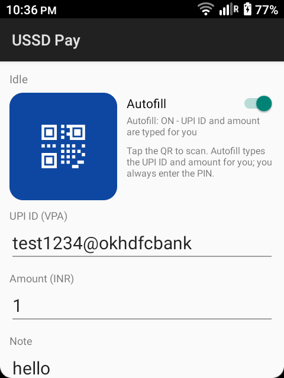

# USSD Pay

Scan a UPI QR code and pay through your bank's **`*99#` (NUUP) USSD menu** — for
phones where normal UPI apps don't work: de-Googled ROMs, devices without Play
Services, or rooted phones that banking apps refuse to run on.

The app scans the QR, pastes the UPI ID and amount into the operator's USSD
dialog for you, and records a receipt you can show a vendor. **You always type
the UPI PIN yourself.**

Because `*99#` travels over the GSM signalling channel rather than the
internet, this also works as an **emergency fallback when the data in your SIM
is over** (or you have no data pack at all) — no mobile data or Wi-Fi is
required to complete a payment.

<p align="center">
  
</p>

---

## How it works

```
 ┌──────────┐   ┌───────────┐   ┌──────────────┐   ┌───────────────┐
 │  Scan a  │ → │  Confirm  │ → │  *99# USSD   │ → │  Autofill the │
 │  UPI QR  │   │  amount   │   │   session    │   │  menu fields  │
 └──────────┘   └───────────┘   └──────────────┘   └───────┬───────┘
                                                            │
                       ┌────────────────────────────────────┘
                       ▼
              ┌─────────────────┐   ┌──────────────────┐
              │ You type the    │ → │ Receipt saved +  │
              │ UPI PIN         │   │ shareable        │
              └─────────────────┘   └──────────────────┘
```

1. **Scan** — camera + ZXing decode any UPI QR
   (`upi://pay?pa=…&am=…&tn=…`) and fill in the VPA, amount and note.
2. **Confirm** — the app asks `Send Rs.X to <vpa> via *99#?` before anything
   leaves the phone.
3. **Session** — `TelephonyManager.sendUssdRequest("*99#")` opens the operator
   menu; Android shows it in `com.android.phone`'s USSD dialog.
4. **Autofill** — an `AccessibilityService` reads each prompt and answers it:

   | Prompt seen in the dialog | Action |
   |---|---|
   | menu containing `N. Send Money` | sends `N` |
   | menu containing `N. UPI …` (labels with "pin" excluded) | sends `N` |
   | `Enter UPI ID` / VPA | pastes the scanned VPA |
   | `Enter amount` | pastes the amount |
   | `Enter a remark` | pastes the note, or `1` to skip when empty |
   | anything containing **PIN** | **stops** — you type it |
   | menu containing `N. Exit` | sends `N`, closing the session |

   Anything it doesn't recognise is left alone rather than guessed at.
5. **PIN** — entered by you. The app never fills, stores or transmits it.
6. **Receipt** — the final USSD screen is parsed for payee, amount and
   Ref/UTR; the row goes into a local database and a receipt dialog with a
   **Share** button appears.

## Features

- QR scanning with no Google/ML dependencies (ZXing core, dexed in)
- Prompt-driven USSD automation — matched by label, not fixed menu numbers
- Bank name captured from the `Select Option: <bank>` header
- Receipt dialog + share sheet (payee, amount, VPA, bank, Ref/UTR, timestamp)
- 30-day transaction history; tap a row to share that receipt
- Scrollable in-app event log showing every prompt and decision
- Runtime title indicator: action bar turns blue and dots animate for as long
  as the USSD session is connected
- Local-only storage, bounded to 30 days / 500 rows

## Requirements

- Android 8.0+ (this build targets Android 11 / API 30)
- A SIM with `*99#` (NUUP) enabled by the bank
- Accessibility permission for the autofill step (optional but recommended)
- `CAMERA` and `CALL_PHONE` permissions

## Build

No Gradle, no AndroidX — a plain `aapt2 → javac → d8 → zipalign → apksigner`
pipeline:

```sh
bash build.sh
```

Expects under `~/toolchain`:

| Component | Path |
|---|---|
| Temurin JDK 17 | `~/toolchain/jdk` |
| Android SDK (`platforms/android-30`, `build-tools/34.0.0`) | `~/toolchain/android-sdk` |
| `zxing-core.jar` (dexed into the APK) | `~/toolchain/zxing-core.jar` |

Output: `build/ussdpay.apk` (debug-signed).

## Install

`adb install` does not work on some ROMs (broken `cmd package`). If so, push the
APK and open it through the on-screen installer:

```sh
adb push build/ussdpay.apk /sdcard/inst/u.apk
adb shell am start -a android.intent.action.VIEW \
  -d "content://com.android.externalstorage.documents/document/primary%3Ainst"
```

After installing an update, re-enable **Settings → Accessibility → USSD Pay** —
Android unbinds accessibility services when the app is replaced.

## Usage

1. Tap the QR button and scan the payee's code
2. Check the VPA and amount, add a note if you want one
3. Tap **Start *99#** and confirm
4. Type your UPI PIN when the USSD dialog asks for it
5. Share the receipt from the dialog, or later from **Transaction history**

## Privacy

- Everything stays on the device: `…/databases/ussdpay.db`
- Passwords/PINs are never stored or logged
- History is bounded to **30 days or 500 rows**, whichever comes first; older
  rows are deleted automatically. The bank statement remains the source of
  truth.
- Nothing is uploaded anywhere; sharing only happens when you tap **Share**

## Limitations

- **Interactive USSD cannot be scripted by apps.** `sendUssdRequest()` is
  single-shot: a second request while the dialog is open returns `-1`
  (`USSD_ERROR_SERVICE_UNAVAIL`). Driving the operator dialog through
  accessibility is the only route.
- USSD sessions expire after roughly 30–60 s of idle time, which is why the VPA
  and amount are pasted instead of typed.
- Menu wording differs per bank; the rules match on labels and leave unknown
  screens to you.
- Some banks do not enable UPI payments over `*99#` at all (balance and
  mini-statement often work when send-money doesn't).

## Project layout

```
src/com/daniel/ussdpay/
  MainActivity.java      form, USSD session, receipt dialog, event log
  ScanActivity.java      camera preview + ZXing decode
  AutoPilotService.java  accessibility service that answers the USSD dialog
  UpiParser.java         upi:// QR parsing
  SuccessParser.java     receipt fields from the final USSD screen
  TxDb.java              bounded SQLite store (30 days / 500 rows)
  TxFormat.java          share text and history rows
  HistoryActivity.java   30-day history
  Session.java           "is a USSD session connected?" state
  UssdLog.java           process-wide event log
  InnerScrollView.java   independently scrollable log pane
res/                     layouts, icons, accessibility config
build.sh                 manual build pipeline
```

## Disclaimer

This is a personal tool for paying from your **own** account over your own
bank's USSD service. USSD menus, limits and fees are controlled by your bank
and telecom operator. Automating a payment flow carries risk — always check the
payee and amount before entering your PIN. No warranty; use at your own risk.

## License

MIT — see [LICENSE](LICENSE).
